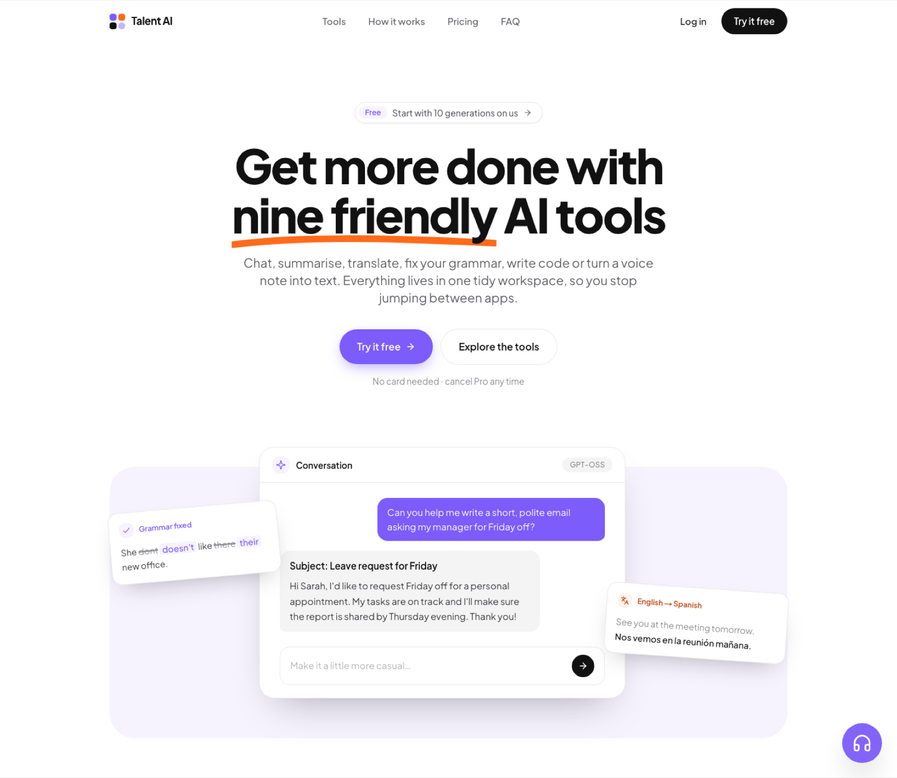

# Talent AI

**Nine friendly AI tools in one workspace** — chat, summarise, translate, fix grammar, paraphrase, write code, analyse sentiment and turn speech into text, with accounts, a free tier and a Stripe-powered Pro plan.



---

## Contents

- [Overview](#overview)
- [Why I built it](#why-i-built-it)
- [Timeline](#timeline)
- [Features](#features)
- [Tech stack](#tech-stack)
- [How it works](#how-it-works)
- [Getting started](#getting-started)
- [Environment variables](#environment-variables)
- [Project structure](#project-structure)
- [Design system](#design-system)
- [Challenges and what I learned](#challenges-and-what-i-learned)
- [Roadmap](#roadmap)
- [Author](#author)

---

## Overview

Most people keep a handful of AI websites open for small, everyday jobs: one to fix an email, another to translate a message, a third to summarise a report. Talent AI puts those jobs in one tidy place.

Each tool does one thing well: open it, paste your text or upload audio, and copy the result. New users get **10 free generations** across every tool; **Pro** ($20/month, billed through Stripe) removes the limit.

It is a full SaaS application rather than a demo: real authentication (Clerk), a PostgreSQL database for usage limits and subscriptions (Prisma + Supabase), Stripe checkout, the billing portal and webhooks, and server-side calls to several AI providers.

## Why I built it

I started Talent AI to learn how a production AI product fits together end to end — not just calling a model, but everything around it:

- **Integrating many AI providers** (Groq, OpenAI, Replicate, ElevenLabs) behind one consistent interface.
- **Building a real SaaS loop**: sign-up → free usage limit → upgrade → subscription kept in sync through webhooks.
- **Working with audio**, which is harder than text: uploads, transcription, translation and speech generation.
- **Keeping secrets safe** in a Next.js app where server and browser code live side by side.

It has also become my playground for trying new models as they come out.

## Timeline

| When | What happened |
|---|---|
| **April 2024** | Project started: Next.js 14 App Router, Clerk auth, Prisma schema for per-user API limits and Stripe subscriptions (first migrations: 19–24 April 2024). |
| **August 2025** | Moved to a clean repository without secrets in history. Fixed Stripe payments, added text-to-audio, speech-to-text and voice-to-voice (with conversation memory). |
| **September 2025** | New database and updated models. |
| **October 2025** | Voice assistant with ElevenLabs, plus a webhook endpoint for testing audio with n8n. |
| **October 2026** | Major refresh: new friendly home page, a three-colour design system, retired Groq models replaced, crashes and security issues fixed, speech translation moved in-house, SEO and icons. |

## Features

| Tool | What it does | Powered by | Status |
|---|---|---|---|
| **Chat** | General assistant for questions, planning and drafting | Groq · `openai/gpt-oss-20b` | ✅ |
| **Summarise** | Turns long text into a few clear points | Groq · `gpt-oss-20b` | ✅ |
| **Translate** | Text translation that keeps the tone | Groq · `gpt-oss-20b` | ✅ |
| **Grammar** | Fixes spelling and grammar, keeps your voice | Groq · `gpt-oss-20b` | ✅ |
| **Paraphrase** | Rewrites text shorter, simpler or more formal | Groq · `gpt-oss-20b` | ✅ |
| **Sentiment** | Labels text Positive, Negative or Neutral | Groq · `gpt-oss-20b` | ✅ |
| **Code** | Plain-English description → working code | Groq · `gpt-oss-120b` | ✅ |
| **Speech translation** | Upload audio → transcript + translation into 7 languages | Groq · Whisper + `gpt-oss-20b` | ✅ |
| **Voice to text / Voice assistant** | Record and transcribe | Groq · `whisper-large-v3` | ✅ |
| **Interview questions** | Practice questions with model answers for any role | Groq · `gpt-oss-20b` | ✅ |
| **Image creator** | Text → image | Pollinations (free) and others | ✅ |
| **Voice to voice** | Talk to the assistant and hear it reply | Groq + ElevenLabs | 🔑 needs `ELEVENLABS_API_KEY` |
| **Image** | Image generation | OpenAI | 🔑 needs `OPENAI_API_KEY` |
| **Music / Video** | Short music clips and video from a prompt | Replicate | 🔑 needs `REPLICATE_API_TOKEN` |
| **Text to audio** | Text → natural speech | Groq TTS | 🚧 moving from the retired `playai-tts` to Orpheus |

**Platform features**

- Sign-in / sign-up with Clerk; every API route checks the session.
- 10 free generations per user, tracked in PostgreSQL.
- Pro plan with Stripe Checkout, the Stripe billing portal and webhooks that keep the subscription in sync.
- Responsive landing page, SEO metadata, Open Graph share image, favicon, `robots.txt` and `sitemap.xml`.

## Tech stack

| Area | Tools |
|---|---|
| **Framework** | Next.js 14 (App Router), React 18, TypeScript |
| **Styling** | Tailwind CSS, shadcn/ui (Radix UI), Lucide icons, Plus Jakarta Sans / Inter |
| **Auth** | Clerk |
| **Database** | PostgreSQL on Supabase, Prisma ORM |
| **Payments** | Stripe (Checkout, billing portal, webhooks) |
| **AI** | Groq (GPT-OSS 20B/120B, Whisper large v3), OpenAI, Replicate, ElevenLabs, Pollinations |
| **Forms & data** | React Hook Form, Zod, Axios, Zustand |
| **Tooling** | Yarn, ESLint |

## How it works

```
Browser ──► Next.js page (client component)
               │  axios POST /api/<tool>
               ▼
         Route handler (server only)
               │ 1. Clerk: is the user signed in?        → 401
               │ 2. Prisma: free generations left / Pro?  → 403 opens the upgrade modal
               │ 3. Call the AI provider with a server-side key
               │ 4. Count the generation (free users only)
               ▼
         JSON back to the page

Stripe Checkout ──► /api/webhook ──► UserSubscription row (create / renew)
```

- **All AI keys stay on the server.** The Groq client lives in `lib/groq.ts`, which imports `server-only`, so the build fails if browser code ever imports it.
- **Usage limits** live in the `UserApiLimit` table; **subscriptions** in `UserSubscription` (see `prisma/schema.prisma`).
- **Speech translation** is two steps on the server: Whisper transcribes the recording, then the chat model translates the transcript into the chosen language.

## Getting started

### Prerequisites

- Node.js 18 or newer and Yarn 1
- A PostgreSQL database (a free [Supabase](https://supabase.com) project works)
- Accounts for [Clerk](https://clerk.com), [Groq](https://console.groq.com) and [Stripe](https://stripe.com) (test mode is fine)
- Optional: OpenAI, Replicate and ElevenLabs keys for the image, music/video and voice features

### 1. Install

```bash
git clone https://github.com/MdShafikulIslam1/talent-ai.git
cd talent-ai
yarn install          # also runs `prisma generate`
```

### 2. Configure

Create a `.env` file in the project root (it is git-ignored) — see [Environment variables](#environment-variables).

### 3. Create the database tables

```bash
npx prisma migrate deploy
```

### 4. Run

```bash
yarn dev
```

Open [http://localhost:3000](http://localhost:3000).

### 5. Test payments locally (optional)

Stripe cannot reach `localhost`, so forward webhooks with the Stripe CLI:

```bash
stripe listen --forward-to localhost:3000/api/webhook \
  --events checkout.session.completed,invoice.payment_succeeded
```

Copy the `whsec_…` secret it prints into `STRIPE_WEBHOOK_SECRET`, then upgrade from the app with the test card `4242 4242 4242 4242`.

### Production build

```bash
yarn build && yarn start
```

When deploying, set `NEXT_PUBLIC_APP_URL` to your real domain and add a Stripe webhook endpoint at `https://<your-domain>/api/webhook` with the two events above.

## Environment variables

| Variable | Required | Used for |
|---|---|---|
| `DATABASE_URL` | ✅ | PostgreSQL connection string |
| `NEXT_PUBLIC_CLERK_PUBLISHABLE_KEY` | ✅ | Clerk (browser) |
| `CLERK_SECRET_KEY` | ✅ | Clerk (server) |
| `NEXT_PUBLIC_CLERK_SIGN_IN_URL` / `NEXT_PUBLIC_CLERK_SIGN_UP_URL` | recommended | `/sign-in`, `/sign-up` |
| `NEXT_PUBLIC_CLERK_AFTER_SIGN_IN_URL` / `NEXT_PUBLIC_CLERK_AFTER_SIGN_UP_URL` | recommended | `/dashboard` |
| `GROQ_API_KEY` | ✅ | Text tools, Whisper (server only — never prefix it with `NEXT_PUBLIC_`) |
| `STRIPE_API_KEY` | ✅ | Stripe secret key (`sk_…`) |
| `STRIPE_WEBHOOK_SECRET` | ✅ for payments | Webhook signing secret (`whsec_…`) |
| `NEXT_PUBLIC_APP_URL` | ✅ | Absolute URLs for Stripe redirects, SEO and share images |
| `OPENAI_API_KEY` | optional | Image tool |
| `REPLICATE_API_TOKEN` | optional | Music and video |
| `ELEVENLABS_API_KEY` | optional | Voice to voice |
| `HUGGING_FACE_API_KEY`, `DEEPAI_API_KEY` | optional | Extra image-creator providers |

## Project structure

```
app/
  (landing)/            Public home page
  (auth)/               Clerk sign-in and sign-up
  (dashboard)/(routes)/ One folder per tool (conversation, code, translation, …)
  api/<tool>/route.ts   Server route per tool, plus stripe/ and webhook/
  icon.svg, apple-icon.tsx, opengraph-image.tsx, robots.ts, sitemap.ts
components/
  home/                 Landing page sections
  ui/                   shadcn/ui components
lib/
  groq.ts               Server-only Groq client
  stripe.ts             Stripe client (pinned API version)
  subscription.ts       Is the user on Pro?
  userApiLimit.ts       Free-generation counter
prisma/                 Schema and migrations
constant.ts             Tool list and the free-generation limit
```

## Design system

The whole app uses **three colours**, defined once as Tailwind tokens in `tailwind.config.ts` and mirrored in the shadcn theme in `app/globals.css`:

| Token | Colour | Role |
|---|---|---|
| `ink` | `#111111` + neutral greys | Text, borders, dark surfaces |
| `brand` | `#7c5cfa` violet | Buttons, links, highlights |
| `flame` | `#ff6b1a` orange | Small accents and errors |

Each has a few tints (`brand-50`, `ink-200`, …). There are no gradients, so changing the brand colour is a one-line edit.

## Challenges and what I learned

- **Models retire under you.** Groq decommissioned `llama-3.1-8b-instant`, `llama3-70b-8192` and `playai-tts`, which silently broke most tools. I moved to `gpt-oss-20b` / `gpt-oss-120b`. Lesson: keep model names in one place and test every provider call regularly. GPT-OSS also *reasons* before answering, so tight `max_tokens` limits need extra headroom.
- **An unused SDK client can take a route down.** Several Groq-only routes still created an OpenAI client at import time. With no `OPENAI_API_KEY`, the OpenAI SDK throws, so those routes returned 500 on every request even though they never used OpenAI. A production build (`next build`) loads every route and is a far better check than calling the AI APIs directly.
- **`NEXT_PUBLIC_` means public.** The Groq key was originally `NEXT_PUBLIC_GROQ_API_KEY` with `dangerouslyAllowBrowser`, and the client lived in a utils file that client components also imported — so the key would ship to every visitor. It now lives in a `server-only` module that browser code can't import, and the built browser bundle contains no keys.
- **Stripe webhooks arrive in any order, and more than once.** `invoice.payment_succeeded` often arrives before `checkout.session.completed`, and failed deliveries are retried. The handler now always responds, upserts the subscription and treats a missing row as "not yet", not as an error. It also re-fetches objects in the API version the app is pinned to.
- **Don't depend on a free server you forgot about.** Speech translation called a separate Flask service on Render that had been deleted. It now runs inside the app (Whisper + translation), so there is one less thing to deploy.
- **Design matters as much as features.** The first landing page looked generic: gradient blobs, invented stats ("50K+ users") and fake testimonials. The redesign uses real UI previews of each tool, honest copy and a strict three-colour palette.

## Roadmap

- [ ] Text to audio on Groq Orpheus (needs the model terms accepted)
- [ ] Per-page titles for the dashboard tools
- [ ] Cancellation and plan-change webhooks (`customer.subscription.updated` / `deleted`)
- [ ] Streaming responses for chat and code
- [ ] Automated tests for the API routes

## Author

**Md Shafikul Islam** — Full-Stack & AI Engineer

- Portfolio: [portfolio.shofik.xyz](https://portfolio.shofik.xyz/)
- GitHub: [@MdShafikulIslam1](https://github.com/MdShafikulIslam1)
- LinkedIn: [shafikul-islam-web-dev](https://www.linkedin.com/in/shafikul-islam-web-dev/)
- Email: mdshafikuli421@gmail.com
